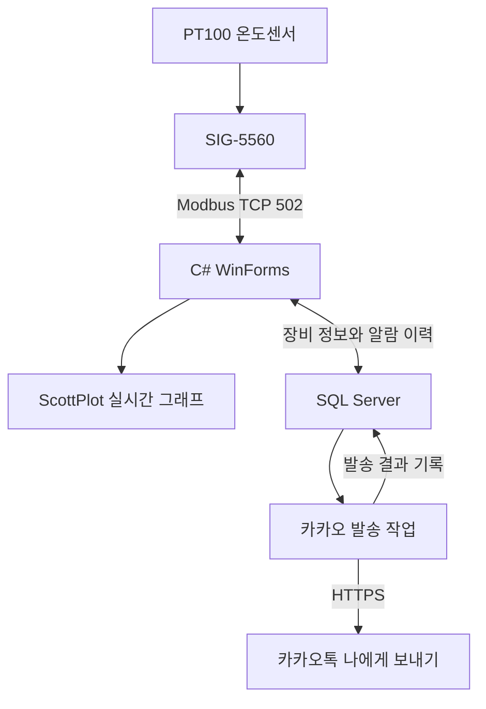

# SIG-5560 실시간 온도 모니터링

PT100 온도센서와 SIG-5560을 연결하고, C# WinForms에서 Modbus/TCP로 온도를 읽어 그래프·고온 알람·SQL Server 이력·카카오톡 알림으로 연결한 개인 프로젝트입니다.

장비 연결을 먼저 확인한 뒤 단건 온도 수신, 주기 수집, 알람 판정, DB 저장, 알림 발송 순서로 구현했습니다. 실제 시험에서는 25.0℃ 수신과 93.6℃ 고온 알람 발생, 작업자 확인, 정상 복귀, 카카오 발송 및 이력 조회를 대조했습니다.

## 개발 기록

| 문서 | 담은 내용 |
| --- | --- |
| [설계 과정](docs/design.md) | 요구사항, 시스템 구조, Modbus 패킷, 알람 상태, DB 관계와 설계 변경 |
| [개발 과정](docs/development.md) | 단계별 구현, 주요 메서드, UI·그래프·DB·알림 연동, AI 활용 |
| [트러블슈팅](docs/troubleshooting.md) | 네트워크 연결 실패, 한글 글꼴, 알람·발송 상태, SQL·Git 문제 해결 |
| [시험 및 확인 범위](docs/verification.md) | 실제 시험 기록, 코드 확인 항목, 추가 시험이 필요한 항목 |
| [실행 및 설정](docs/setup.md) | 새 PC 실행, SQL 스크립트 순서, 사용자 비밀, 장비 등록, 라이선스 수집 |

## 시스템 구조



센서 상태를 먼저 요청하고, 정상 상태이면 온도를 요청합니다. C#에서 고온·복귀를 판정하고, 저장 프로시저로 발생 이력과 발송 대기를 함께 기록합니다. 별도 비동기 작업이 발송 대기를 조회해 카카오 API를 호출합니다.

## 주요 기능

- 약 1초 주기로 센서 상태와 온도를 조회하고 현재 온도·상태·시각을 표시합니다.
- 최근 10분 추이를 표시하고, 수신 공백에는 그래프 선을 끊습니다.
- 현재 코드에서 80.0℃ 이상 연속 3회이면 고온, 40.0℃ 이하 연속 3회이면 정상 복귀로 판정합니다.
- 고온, 센서 오류, 통신 끊김의 발생·작업자 확인·복귀 시각을 기록합니다.
- 고온 알람에 대한 카카오톡 발송 상태와 오류를 저장합니다.
- 날짜·알람 유형으로 이력을 조회하고, 사용한 NuGet 패키지의 라이선스 원문을 열 수 있습니다.

## 사용 기술

| 영역 | 구성 |
| --- | --- |
| 실행 환경 | Windows, .NET 8, WinForms |
| 장비 통신 | TcpClient, NetworkStream, Modbus/TCP FC04 |
| 비동기 처리 | async/await, PeriodicTimer, CancellationTokenSource |
| 그래프 | ScottPlot.WinForms 5.1.59, Noto Sans CJK KR |
| DB | SQL Server, Microsoft.Data.SqlClient 7.1.1, 저장 프로시저 |
| 알림 | HttpClient, 카카오톡 나에게 보내기 API |
| 설정·라이선스 | .NET User Secrets, nuget-license |

## 실제 시험에서 확인한 흐름

| 항목 | 기록 |
| --- | --- |
| 정상 수신 | TCP 연결 후 25.0℃ 표시와 그래프 확인 |
| 고온 판정 중 | 90.0℃ 수신 화면에서 연속 판정 2/3 확인 |
| 고온 발생 | 알람 19번, 발생 온도 93.6℃, 16:07:35 |
| 작업자 확인 | 같은 알람에 16:08:00 확인 시각 기록 |
| 정상 복귀 | 같은 알람에 16:08:19 복귀 시각 기록 |
| 알림·이력 | 카카오 메시지와 발송 성공 상태, 이력 조회 결과 대조 |

위 값은 개발 당시 실장비 시험 기록입니다. [시험 기록과 검증 범위](docs/verification.md)

## 실행

Windows에 .NET 8 SDK, 접속 가능한 SQL Server, SIG-5560 장비가 필요합니다. 현재 코드는 시작 시 DB 연결 문자열을 읽으므로 첫 실행 전에 사용자 비밀을 설정해야 합니다.

```powershell
git clone https://github.com/EddieEom/Temperature_ModBus.git
cd Temperature_ModBus
dotnet restore
```

[실행 및 설정](docs/setup.md)에 따라 DB·장비·사용자 비밀을 준비한 뒤 실행합니다.

```powershell
dotnet run --project .\Temperature_Modbus\Temperature_Modbus.csproj
```

현재 DB에는 알람 이벤트와 발송 결과를 저장합니다. 매초 수집한 전체 온도 시계열은 그래프의 메모리 데이터로 관리합니다.

## AI 활용

개발 순서와 단계별 확인 항목을 정리하고, 반복적인 UI 설정·SQL 매개변수 작성·주석 및 문서 초안 정리에 AI를 활용해 생산성을 높였습니다. 장비 접속 정보 확인, 실제 배선 점검, 오류 재현, 온도 수신과 알람 결과 대조를 통해 적용 결과를 확인했습니다. 활용 범위는 [개발 과정](docs/development.md#ai-활용)에 기록했습니다.

## 기록 기준

구현 설명은 소스 커밋 `728a3a6d74eb2a9feabbeb737930c0db223c7c33`을 기준으로 작성했습니다. 설계 당시 검토 사항과 현재 구현의 차이, 실행 환경에 따른 제약은 각 상세 문서에 함께 기록했습니다.
