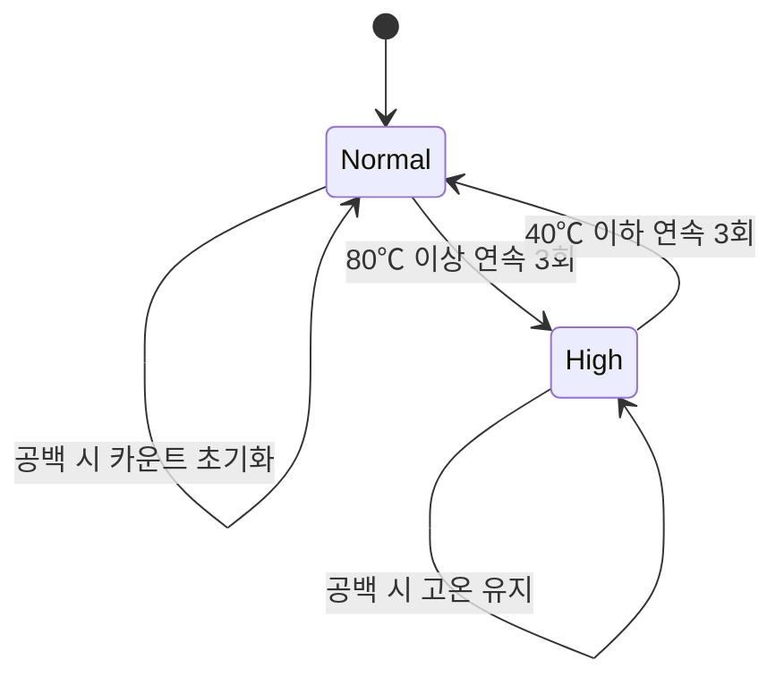
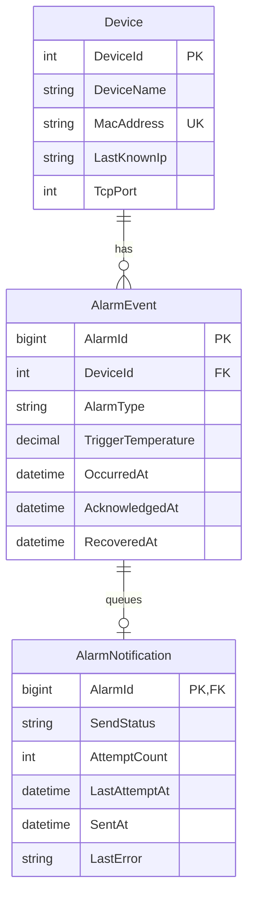

# 설계 과정

[프로젝트 홈](../README.md) · [개발 과정](development.md) · [트러블슈팅](troubleshooting.md)

## 목표와 구현 순서

온도센서의 값을 화면에 표시하고 이상 온도를 알람·이력·메시지로 추적하는 것을 목표로 정했습니다. 2026년 11월 5일부터 진행한 대화에서 먼저 통신 연결 버튼을 구현하고, 실제 연결이 확인되면 온도 수신으로 확장하는 순서를 잡았습니다.

| 단계 | 먼저 확인할 것 | 이후 확장 |
| --- | --- | --- |
| 장비 접속 | 배선, 실제 장비 주소, TCP 502 연결 | 레지스터 단건 요청 |
| 값 해석 | 센서 상태와 온도 값, 부호·배율 | 약 1초 주기 수집 |
| 화면 | 현재 온도와 수신 상태 | 최근 추이·기준선·결측 표시 |
| 알람 | 고온 발생과 복귀 판정 | DB 저장·작업자 확인·이력 |
| 알림 | 한 알람의 발송 대상 등록 | 카카오 발송과 결과 추적 |

## 네트워크와 통신 역할

PT100 센서를 SIG-5560에 연결하고, 장비 Ethernet과 PC가 통신할 수 있는 네트워크를 구성했습니다. SIG-5560은 TCP Server 및 Modbus Slave, WinForms는 요청을 보내는 TCP Client 역할입니다. USB SETUP 연결은 장비 설정 경로로 검토했고, 실제 온도 수집은 Ethernet의 Modbus/TCP로 구현했습니다.

초기에는 노트북 Wi-Fi와 장비 유선 LAN의 연결 경로를 확인해야 했습니다. 장비 IP는 spFinder와 공유기 DHCP 목록에서 확인하고, 스위치 포트 번호와 구분했습니다. 실제 연결 실패 및 해결 순서는 [트러블슈팅](troubleshooting.md#장비-ip를-확인하기까지)에 남겼습니다.

## Modbus 요청과 응답

현재 코드는 Unit ID 1과 FC04를 사용합니다.

| 조회 대상 | 레지스터 시작 주소 | 길이 | 처리 |
| --- | --- | --- | --- |
| 센서 상태 | 8 | 1 WORD | 0이면 온도 조회, 그 외에는 센서 오류 표시 |
| 온도 | 0 | 1 WORD | signed 16-bit 정수로 해석한 뒤 10으로 나눔 |

요청 패킷은 12바이트입니다.

| 바이트 위치 | 필드 | 값 또는 역할 |
| --- | --- | --- |
| 0–1 | Transaction ID | 요청마다 증가하는 16-bit 값 |
| 2–3 | Protocol ID | 0 |
| 4–5 | Length | 6 |
| 6 | Unit ID | 1 |
| 7 | Function Code | 0x04 |
| 8–9 | Starting Address | 센서 상태 8 또는 온도 0 |
| 10–11 | Quantity | 1 |

다중 바이트 값은 Big Endian으로 작성합니다. 응답은 MBAP 헤더 7바이트를 먼저 읽고, Length에서 이미 읽은 Unit ID 1바이트를 뺀 길이만큼 본문을 읽습니다. TCP 데이터가 나뉘어 도착하는 경우를 고려해 `ReadExactlyAsync`를 사용했습니다.

응답 Transaction ID·Protocol ID·Unit ID·길이·기능 코드·바이트 수를 확인합니다. 0x84 예외 응답은 오류 코드와 함께 처리합니다. 정상 온도 raw 250은 25.0℃가 됩니다.

## 수집 주기와 시간 제한

| 작업 | 현재 설정 | 의미 |
| --- | --- | --- |
| 수집 루프 | PeriodicTimer 1초 | 처리 완료와 응답 시간에 따라 실제 갱신 간격은 달라짐 |
| 연결 시도 | 5초 | 장비 DB 조회와 TCP 연결에 같은 취소 제한 적용 |
| 한 주기 레지스터 요청 | 3초 | 센서 상태·온도 조회에 공유하는 제한 |
| 카카오 대기 조회 | 약 2초 주기 | 수집 루프와 별도 비동기 작업 |
| HTTP 발송 | 10초 | 요청 취소 및 시간 초과 처리 |
| 이력 조회 | 전체 취소 15초 | SQL 명령 제한은 10초 |

1초 주기는 타이머 설정입니다. DB와 네트워크 응답을 포함한 갱신 지연 측정은 별도 시험 항목으로 남아 있습니다.

## 고온과 복귀

설계 초기에 50℃ 발생·48℃ 복귀와 같은 가까운 임계값을 검토했습니다. 현재 구현과 저장 프로시저 메시지는 80℃ 발생·40℃ 복귀로 맞춰져 있습니다.

| 현재 상태 | 정상 온도 샘플 | 판정 |
| --- | --- | --- |
| 정상 | 80.0℃ 이상 | 고온 카운트 증가, 3회에서 발생 |
| 정상 | 80.0℃ 미만 | 고온 카운트 초기화 |
| 고온 | 40.0℃ 이하 | 복귀 카운트 증가, 3회에서 복귀 |
| 고온 | 40.0℃ 초과 | 복귀 카운트 초기화 |
| 센서 오류·통신 공백 | 유효 온도 없음 | 연속 카운트 초기화, 기존 고온 상태 유지 |

현재 센서 오류는 상태 레지스터 값으로 반영합니다. 통신 수신 예외·시간 초과가 발생하면 연결을 정리하고 COMM_LOST를 저장합니다. 정상 Modbus 응답이 다시 오면 통신 복귀를 반영합니다. 초기 설계에서 검토한 통신 3회 연속 실패·복귀 판정은 현재 코드의 통신 장애 처리와 차이가 있습니다.

## 알람 발생·확인·복귀

세 시각을 독립적으로 관리했습니다.

| 필드 | 의미 |
| --- | --- |
| OccurredAt | 알람 발생을 DB에 등록한 시각 |
| AcknowledgedAt | 작업자가 확인 버튼을 누른 시각 |
| RecoveredAt | 정상 복귀를 DB에 기록한 시각 |

확인 버튼을 눌러도 고온 상태가 유지될 수 있습니다. 정상 복귀가 먼저 이뤄져도 미확인 이력이 남을 수 있습니다. 활성 알람 화면은 `RecoveredAt IS NULL OR AcknowledgedAt IS NULL` 조건으로 조회합니다.

고온 발생 온도 `TriggerTemperature`는 최초 발생 순간의 값으로 보존합니다. 알람 19번이 93.6℃에서 발생했다면 이후 현재 온도가 변해도 발생 온도는 유지됩니다. 복귀한 다음 다시 발생하면 새 AlarmId로 기록합니다.

## DB 구조

알람 종류는 HIGH_TEMP, SENSOR_ERROR, COMM_LOST입니다. `RecoveredAt IS NULL`인 행에 대해 장비·알람 종류의 필터링된 고유 인덱스를 적용했습니다. 저장 프로시저에서도 `UPDLOCK, HOLDLOCK`과 트랜잭션으로 기존 활성 알람을 확인합니다.

`SaveHighTemperatureAlarm`은 새 발생 시 AlarmEvent와 AlarmNotification을 같은 트랜잭션에서 등록합니다. `SaveDeviceFault`는 센서·통신 오류의 발생 및 복귀를 기록합니다. DB 시각은 UTC로 저장하고 화면에서 변환합니다.

## 발송 상태

현재 카카오 발송 대상은 아직 복귀하지 않은 고온 알람 중 PENDING이고 AttemptCount가 0인 건입니다. 발송 대상을 UPDATE로 선점하고 시도 횟수와 시각을 기록한 뒤 HTTP 호출을 수행합니다. HTTP 성공 응답과 JSON `result_code = 0`을 확인하면 SENT, 그 외에는 FAILED를 기록합니다.

발송 시도 후 실패한 건을 자동 재시도하는 정책과 토큰 자동 갱신은 현재 구현에 포함되어 있지 않습니다. 선점 직후 프로세스가 종료되면 PENDING·AttemptCount 1 상태가 남을 수 있습니다. 카카오 수신과 DB 결과 기록 사이에 프로세스가 종료되는 경우도 있어, 외부 메시지 전달의 정확히 한 번 보장은 현재 범위 밖에 있습니다.

## 설계 검토와 구현 상태

| 검토 내용 | 현재 구현 |
| --- | --- |
| 반복 측정에 따른 알람 중복 억제 | 상태 전환 시 저장, 저장 프로시저·고유 인덱스 적용 |
| 앱 재시작 후 고온 상태 유지 | 연결 전 DB의 미복귀 고온 상태 조회 |
| 센서·통신 공백을 정상 온도로 해석하지 않기 | 현재값 공백, 그래프 NaN, 연속 판정 초기화 |
| 알람과 발송 의도의 함께 저장 | 동일 DB 트랜잭션 적용 |
| DB 장애 시 로컬 내구성 큐 | 초기 검토 사항, 현재 소스에서 구현 확인 안 됨 |
| 매초 온도 영구 보관 | 현재 그래프 메모리 데이터만 유지 |
| 자동 재연결·발송 자동 재시도 | 현재 사용자 재연결 및 단일 발송 시도 방식 |

구현 근거는 [MainForm.cs](../Temperature_Modbus/MainForm.cs)와 [SQL 폴더](../SQL)입니다.

## 설계표와 시험 화면의 연결

설계표에서 Device의 MacAddress는 DHCP로 IP가 바뀌어도 같은 장비를 식별하기 위한 고유 값이고 LastKnownIp와 TcpPort는 접속 정보입니다. AlarmEvent의 bigint AlarmId는 그리드에서 선택한 행을 식별하며 AlarmNotification에서는 같은 값을 기본 키와 외래 키로 사용합니다. 이 관계 덕분에 18번의 ‘발송 대기’ 화면과 최종 ‘발송 성공’ 이력, 실제 수신 메시지를 한 건으로 추적할 수 있었습니다. [시험 기록](verification.md)
